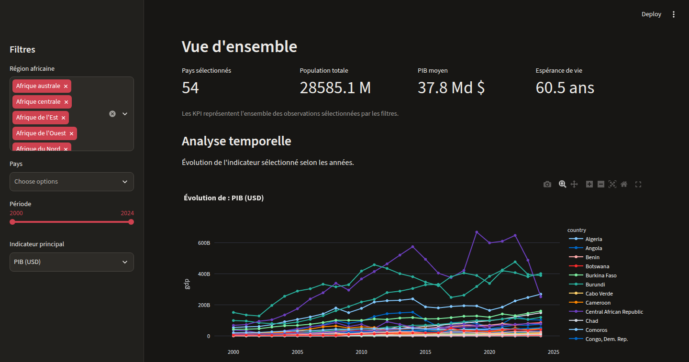
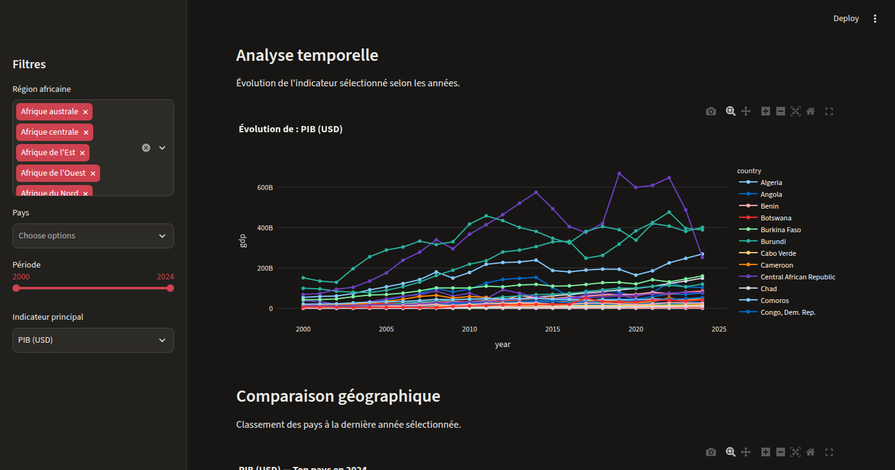
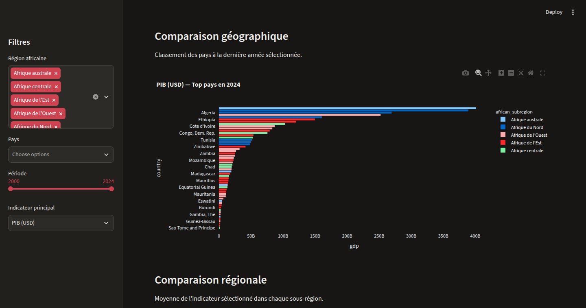
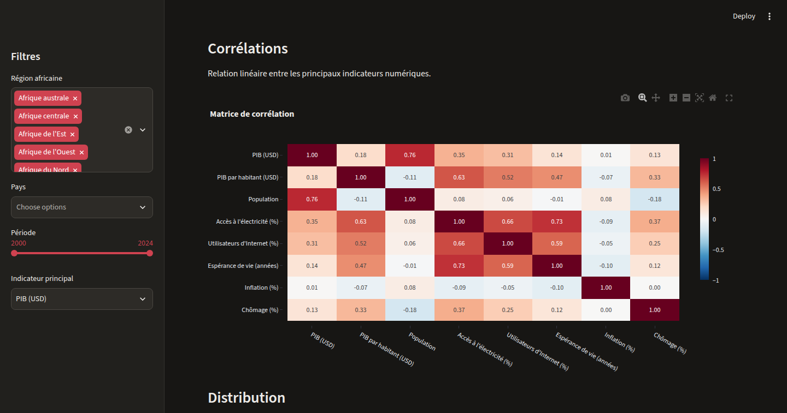
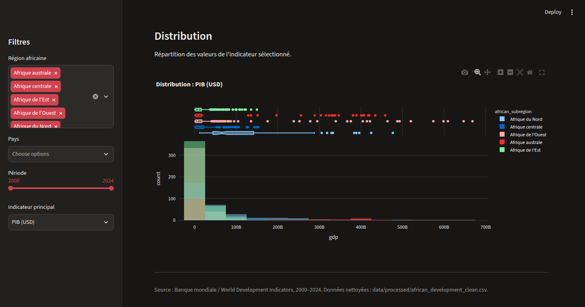

# S2 Dashboard Streamlit

**Parcours** : Formuloo Data  
**Niveau** : Tous niveaux  
**Branche de livraison** : ta branche `prenom-nom`

## Convention de branchement — OBLIGATOIRE

```bash
git clone https://gitlab.formuloo.com/formuloo-data/mini-projets/s2-dashboard-streamlit.git
git checkout develop
git pull origin develop
git checkout -b prenom-nom   # ex: jean-dupont, sans accents, minuscules
```

Pour chaque feature ou tâche, crée une sous-branche :
```bash
git checkout -b prenom-nom/feature/nom-feature
# ... travail ...
git checkout prenom-nom
git merge prenom-nom/feature/nom-feature
git push origin prenom-nom
```

**Ta branche `prenom-nom` est ta branche de livraison — c'est ce qui sera évalué.**  
Ne jamais pousser directement sur `develop` ou `main`.

## Dashboard déployé

- URL publique : https://s2-dashboard-app-epxs7cmqjxdyovupyxffbx.streamlit.app/
- Application Streamlit : `app/streamlit_app.py`
- Notebook d'exploration : `notebooks/exploratory_analysis.ipynb`
- Conclusions principales : `INSIGHTS.md`

## Livrables

- Collecte des données : `src/collect_data.py`
- Nettoyage des données : `src/clean_data.py`
- Analyse exploratoire : `src/explore_data.py`
- Données brutes : `data/raw/african_development.csv`
- Données nettoyées : `data/processed/african_development_clean.csv`
- Rapports d'analyse : `data/processed/`

## Installation et exécution locale

```bash
python -m pip install -r requirements.txt
python src/collect_data.py
python src/clean_data.py
python src/explore_data.py
streamlit run app/streamlit_app.py
```

## Captures d'écran du dashboard

### 1. Vue d'ensemble



### 2. Analyse temporelle



### 3. Comparaison géographique



### 4. Corrélations



### 5. Distribution


